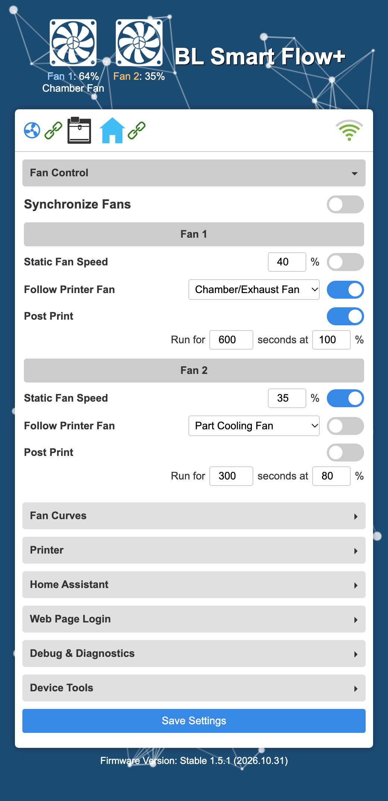
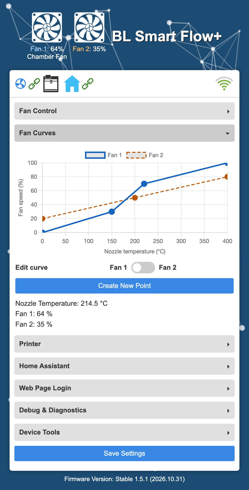
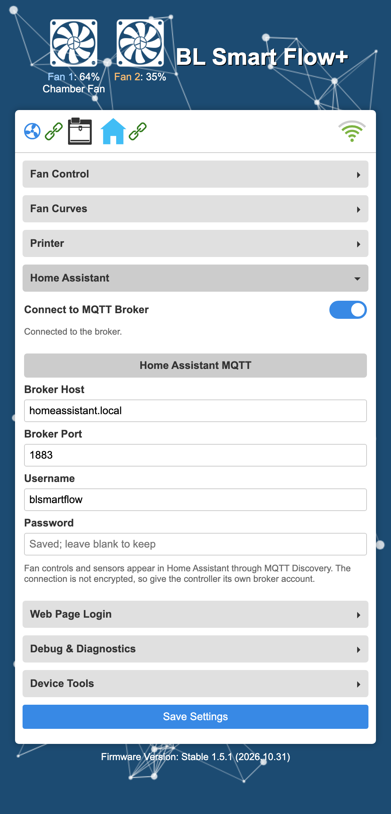
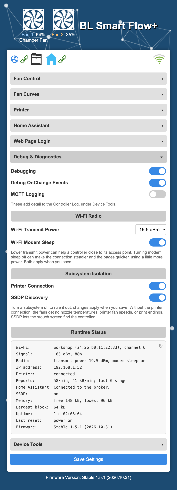
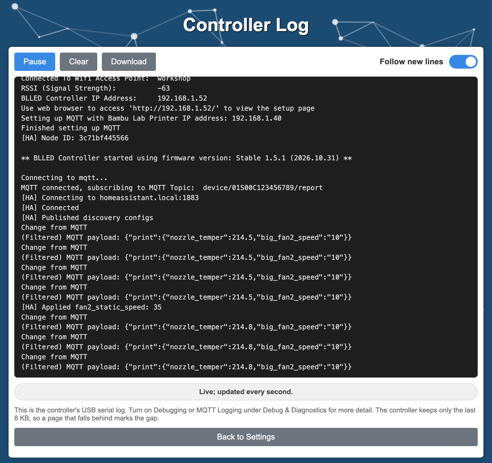

## BLSMARTFLOW

The BLSmartflow is an ESP32 based device that connects to your Bambulab X1,X1C,P1P Or P1S and controls fans based on the temperature of the printer.

### Features

- Connects to Bambulab H2D,X1,X1C,P1P Or P1S
- Controls Fans based on printer temperature

### BL Smart Flow+ Features

- Synchronized or independent control of both fans
- Per-fan temperature curve editing
- Per-fan static speed overrides
- Per-fan following the reported speed of a printer fan
- Per-fan Post Print timers with a chosen duration and speed
- Separate animated fan indicators
- Home Assistant monitoring and control over MQTT, with automatic discovery
- A single Settings page with collapsible sections and a status bar for Wi-Fi, the printer, and Home Assistant
- Debug & Diagnostics with live runtime status, Wi-Fi radio tuning, and subsystem switches
- Device Tools for firmware updates, settings backup and restore, a live controller log, and restarts

### Changelog

See [CHANGELOG.md](CHANGELOG.md) for the release history.

### Development Environment

To contribute to the Smartflow project, you'll need the following tools:

### Tools & Libraries Used

- [Visual Studio Code](https://code.visualstudio.com/): A lightweight and powerful source code editor.
- [PlatformIO](https://platformio.org/): An open-source ecosystem for IoT development.
- [Python](https://www.python.org/): A programming language used for scripting and automation.
- [qpdf](https://qpdf.sourceforge.io/): A command-line tool and library of compression tools (`gzip`)

### Building and Running the Project
1. Clone the repository to your local machine.
2. Open the project folder in Visual Studio Code.
3. Ensure that PlatformIO is installed and configured in your Visual Studio Code environment. `platformio.ini` pins the `espressif32@6.9.0` platform (Arduino-ESP32 2.0.17), because the ESP32SSDP library does not build on newer ones.
4. Connect your Smartflow device ESP32 to your computer.
6. Build the project by clicking on the PlatformIO icon in the sidebar and selecting "Build" from the available options.
7. Once the build process is complete, upload the firmware to your device using the "Upload" option in PlatformIO.
8. After uploading the firmware, your BLSmartflow device should be ready to use.

### Setup Instructions
Once you have uploaded the firmware to your device, please visit the [dutchdevelop.com/blsmartflow](https://www.dutchdevelop.com/blsmartflow) website for detailed setup instructions.


### Development Notes

#### Firmware Versioning

Versions use **major.feature.build**: the first number changes for a major overhaul, the middle number for feature additions, and the last number increments for every firmware build.

`version_build.py` compiles each firmware build with the next build number, including when Upload builds new firmware, and writes that number to `platformio.ini` once the firmware image is built. A failed build does not consume its number. The file is left alone while compiling because PlatformIO deletes the build directory when one of its commands, such as the editor's IntelliSense index rebuild, finds `platformio.ini` changed; after writing the number, the script also updates PlatformIO's record of the file, so the finished build is kept. Cleaning, IDE metadata, filesystem-only operations, and uploading an existing binary with `nobuild` do not increment it. Commit the updated `custom_version` with the changes being built. When starting a new feature series or major version, update the corresponding number in `custom_version`; the next build increments its final number as usual.

The compiler and `.firmware` output filenames use the same reserved version. The displayed date comes from the build machine's local date. Web pages load the version from the firmware instead of keeping a separate hardcoded copy.

Each build also writes the OTA-ready image to `build/esp32dev/firmware-<version>.bin`, for example `firmware-1.3.8.bin`. Use this versioned file when uploading through the web UI. PlatformIO's internal `firmware.bin` remains available for its upload and merge steps.

#### Settings Page

<p>
  
  
</p>

The controller's web page is a single Settings page, styled after the BLLED controller's pages on a blue background. The header shows an animated indicator for each fan with its current speed, and beneath it the printer fan being followed or the Post Print countdown. Below the header, a status bar shows three connections, refreshed every second:

- **Printer**: a green link while the printer connection is up, otherwise a red broken link.
- **Home Assistant**: a faded house while the connection is switched off, then a green link once connected or a red broken link while connecting or disconnected.
- **Wi-Fi**: signal bars colored from red for a weak signal to green for a strong one, scaled from 0% at -85 dBm to 100% at -60 dBm.

Hovering over an icon shows its details, such as `Wi-Fi signal: 72% (-67 dBm)`, `Printer: connection turned off`, or `Home Assistant: Not connected: the broker rejected the username or password.`

The settings are grouped into collapsible sections: **Fan Control**, **Fan Curves**, **Printer**, **Home Assistant**, **Web Page Login**, **Debug & Diagnostics**, and **Device Tools**. Fan Control is open when the page loads, and opening a section closes the one that was open. Switches sit on the right of the settings they control. **Save Settings**, at the bottom, saves every section at once, and a confirmation appears in the middle of the page for four seconds. Fan curve points save on their own, described below.

Earlier versions had separate **Settings** and **Fan Graph** tabs; the fan graph is now the **Fan Curves** section. The Firmware Update, Backup & Restore, and Controller Log pages share the Settings page's style and animated background.

#### Independent Fan Control

**Synchronize Fans: On** uses Fan 1's curve and static-speed override for both outputs. This is also the default after upgrading from 1.0.x. Fan 1 is GPIO 17; Fan 2 is GPIO 16. Both curves use the printer's nozzle temperature.

Set synchronization to **Off** and save to configure the fans separately. Fan 2 initially copies Fan 1's current settings. The **Fan Curves** section of Settings shows both curves; the **Edit curve** switch selects **Fan 1** on the left and **Fan 2** on the right. Clicking a point also selects its fan and opens the editor; overlapping points prefer the currently selected fan. Pressing Enter in a point's temperature or speed field applies it, like **Change**. Valid point changes save automatically, with a confirmation that disappears after four seconds. Each fan's static-speed switch overrides its own curve with the entered percentage.

Switching synchronization back On preserves Fan 2's curve and static settings, including across restarts. Switching Off again restores them. Configuration changes take effect after a successful Save; unsaved changes to the synchronization selector do not change the running fan mode.

The existing HTTP endpoints remain available: `points` and `speed` still describe Fan 1. `/getFanConfig` adds `points2` and `fansSynchronized`; `/sensorData` adds `speed2`. To update a specific curve, POST `fan=1` or `fan=2` to `/updateFanConfig` alongside the existing `points` form field containing `{"points":[{"temp":0,"speed":0},...]}`. Omitting `fan` selects Fan 1.

#### Follow Printer Fan

Below each **Static Fan Speed** row, enable **Follow Printer Fan**, choose a source, and save. The output mirrors that printer fan's reported percentage. The two switches are mutually exclusive, and either can always be switched off. When both are off, the output uses its temperature curve. **Synchronize Fans: On** applies Fan 1's settings to both outputs; switching it Off restores Fan 2's saved settings. The selected source appears in white below the speed indicator after a successful save.

| Source | MQTT field | Indicator label |
| --- | --- | --- |
| Part Cooling Fan | `print.cooling_fan_speed` | Part Cooling Fan |
| Auxiliary Cooling Fan | `print.big_fan1_speed` | Auxiliary Fan |
| Chamber/Exhaust Fan | `print.big_fan2_speed` | Chamber Fan |
| Hotend/Heatbreak Fan | `print.heatbreak_fan_speed` | Hotend Fan |

The packed `print.fan_gear` field contains three 0–255 values (part, auxiliary, chamber) and takes precedence when present. Those values are rounded to the nearest 10% step to match [Bambu Studio's fan display](https://github.com/bambulab/BambuStudio/blob/master/src/slic3r/GUI/Widgets/FanControl.cpp). For example, PWM 180 becomes 70%, not 71%. Separate 0–15 fields for these three fans use `floor(raw / 1.5) * 10`, matching [Bambu Studio's decoder](https://github.com/bambulab/BambuStudio/blob/master/src/slic3r/GUI/DeviceCore/DevFan.cpp). Hotend/heatbreak readings use a separate 0–15 scale and are converted to the nearest whole percentage. These are reported speed levels, not RPM measurements; a source is usable only if the printer reports it. Static speeds and curve speeds are not rounded to 10% steps.

Each source starts at **0% after boot** and keeps its last valid speed when MQTT disconnects, a field is omitted, or a value is malformed. An explicitly reported zero stops the following output. Speeds are kept in RAM; only the follow settings are saved to flash. Existing configurations load with following Off.

`/getOptions` and `/submitOptions` add `followPrinterFan` and `printerFanSource` (and `followPrinterFan2` / `printerFanSource2`). Sources are `part`, `auxiliary`, `chamber`, or `heatbreak`. The form posts explicit `on`/`off` values; requests enabling both overrides are rejected. `/sensorData` adds `printerFans`, containing each source's last percentage or `null` before its first report.

#### Post Print

Enable **Post Print** below **Follow Printer Fan**, enter a duration in seconds (1–86400) and a speed (0–100%), and save. For example, **600 s at 100%** runs for ten minutes. Post Print can be enabled alongside either normal override; it does not change the Static Fan Speed or Follow Printer Fan switches.

After observing `RUNNING` on the current MQTT connection, the next `FINISH`, `FAILED`, or `IDLE` report starts the timer. Partial updates and intervening `PREPARE` or `PAUSE` reports preserve that observation. Repeated end reports do not restart it. `PREPARE`, `RUNNING`, and `PAUSE` do not cancel or alter an already running countdown.

During the timer, its speed takes priority over the normal mode, and **Post Print: 600s** (with the remaining seconds) replaces the source label beneath the fan percentage. Telemetry refreshes every second. When the timer expires, the fan returns to its current static speed, last reported printer-fan speed, or temperature curve. A reset or detected Wi-Fi/MQTT disconnect clears both timers and the previous running observation; reconnecting to an end state cannot start an old timer. Only settings are stored in flash.

**Synchronize Fans: On** applies Fan 1's Post Print settings and countdown to both outputs, retaining Fan 2's settings for later. Changing synchronization cancels active timers. Saving a change to a fan's Post Print settings cancels its current timer; failed saves leave it running. Older configurations default Post Print to Off, with editable defaults of 600 seconds and 100%.

`/getOptions` and `/submitOptions` use `postPrint`, `postPrintSeconds`, and `postPrintSpeed`, with a `2` suffix for Fan 2. `/sensorData` returns `postPrintRemaining` and `postPrintRemaining2` as whole seconds rounded up, or zero when inactive. Synchronized outputs report the same remaining time.

#### Home Assistant

The controller can connect to your Home Assistant MQTT broker, such as the Mosquitto add-on with the MQTT integration. This is a second connection; the printer connection is unchanged. Under **Home Assistant** in Settings, switch on **Connect to MQTT Broker**, enter the broker host and port (usually 1883), add a username and password if the broker needs them, and save. The device appears as **BL Smart Flow+** under *Settings → Devices & services → MQTT* within a few seconds. The line below the switch and the Home Assistant icon in the status bar show whether it is connected or why it is not, such as a rejected username or password or a broker that can't be reached. The connection is retried every 5 seconds at first, slowing to once a minute while the broker is unreachable. The **Controller Log**, under **Device Tools**, records each connection attempt and every command applied or ignored, in lines starting with `[HA]`.



The saved password is never sent back to the web page. Leave the field blank to keep it, or clear the username to remove both. To prevent the saved password from being sent to a different broker, you must re-enter it when you change the broker host. Like the Wi-Fi password and printer access code, it is stored on the device in plain text.

The connection is plain, unencrypted MQTT, so the broker password crosses your network in the clear; give the controller its own broker account. TLS is not supported because a second TLS session, alongside the printer's, leaves the ESP32 short of memory.

| Entity | Type | Notes |
| --- | --- | --- |
| Nozzle temperature | Sensor | Temperature used by the fan curves, °C |
| Fan 1 speed, Fan 2 speed | Sensor | Current output, % |
| Fan 1/2 Post Print remaining | Sensor | Seconds, or 0 when inactive |
| Printer connection | Binary sensor | Diagnostic; on while the printer MQTT connection is up |
| Synchronize fans | Switch | Same as **Synchronize Fans** |
| Fan 1/2 mode | Select | `Temperature Curve`, `Static Fan Speed`, or `Follow Printer Fan` |
| Fan 1/2 static speed | Number | 0–100 %; used in `Static Fan Speed` mode |
| Fan 1/2 printer fan | Select | Source for `Follow Printer Fan`; same labels as Settings |
| Fan 1/2 Post Print | Switch | Same as **Post Print** |
| Fan 1/2 Post Print duration, speed | Number | 1–86400 s and 0–100 % |

Changes from Home Assistant follow the same rules as **Save** on the Settings page: each is checked, written to flash, then applied, and invalid values are ignored. Repeating the current value does not write to flash. While the fans are synchronized, Fan 1's entities control both outputs and Fan 2's controls are unavailable, keeping their settings for later; the Fan 2 speed sensor still reports the output. Curves are edited only in the **Fan Curves** section of Settings. An open Settings page reloads when Home Assistant changes a setting. If it has unsaved edits, it keeps them and warns that saving will replace the newer settings.

Topics use `blsmartflow/<mac>`, where `<mac>` is the controller's lowercase MAC address without colons:

| Topic | Payload |
| --- | --- |
| `blsmartflow/<mac>/status` | `online` or `offline`; retained, with `offline` as the last will |
| `blsmartflow/<mac>/state` | Retained JSON with every entity's value, such as `fan1_speed` and `fan1_mode`; published within a second of a change |
| `blsmartflow/<mac>/set/<field>` | Command for a control's `<field>`, such as `set/fan1_static_speed` with `42` or `set/synchronized` with `OFF` |
| `blsmartflow/<mac>/fan2/availability` | `offline` while synchronized, otherwise `online` |

Discovery configs are retained under `homeassistant/<component>/blsmartflow_<mac>/<field>/config` and republished when Home Assistant sends `online` to `homeassistant/status`. `/getOptions` and `/submitOptions` use `haEnabled`, `haHost`, `haPort`, `haUser`, and `haPassword`; `/getOptions` returns `haPasswordSet` instead of the password. `/getOptions` and `/sensorData` add `settingsRevision`, which increases when Settings change. `/sensorData` adds `homeAssistant` (`disabled`, `connecting`, `connected`, or `disconnected`) and `homeAssistantState`, the MQTT client's last connection state.

#### Web Page Login and Firmware Updates

Under **Web Page Login** in Settings, enter a username and password and save; your browser then asks for them. The login protects every page and request, including firmware updates. Until one is set, Settings warns that anyone on your network can change the settings or the firmware. Leave the password blank to keep it, or clear the username to remove the login. If you forget the login, run the USB Wi-Fi setup again, which clears it. The browser sends the login with every request over plain HTTP, so use a password you don't use elsewhere.

Requests that change something, whether settings, curves, or firmware, must carry an `X-BLSmartFlow` header, which the controller's own pages send. Another website can't add a custom header without the browser first asking the controller, which never agrees. So another site can't change the controller through your browser, even if your browser has saved the login. Such requests receive 403.

To update the firmware, open **Device Tools** in Settings and choose **Firmware Update**, which opens `/update`, and upload `build/esp32dev/firmware-<version>.bin`. The login and header are checked before anything is written. The controller restarts only after a complete, valid update; otherwise it keeps running the current firmware. From a script, send both:

```sh
curl -u <user>:<password> -H 'X-BLSmartFlow: 1' -F firmware=@build/esp32dev/firmware-1.4.13.bin http://<controller-ip>/update
```

`/getOptions` and `/submitOptions` use `webUser` and `webPassword`; `/getOptions` returns `webPasswordSet` instead of the password.

#### Debug & Diagnostics

The **Debug & Diagnostics** section of Settings holds the **Debugging**, **Debug OnChange Events**, and **MQTT Logging** switches, which add detail to the Controller Log. It also holds these settings, which apply when you save:

- **Wi-Fi Transmit Power**, from 2 to 19.5 dBm. It defaults to 19.5 dBm, the maximum and the earlier fixed setting. A lower power can help a controller close to its access point.
- **Wi-Fi Modem Sleep**, on by default as on any ESP32. Turning it off can make the connection steadier and the pages quicker, using a little more power.
- **Printer Connection** and **SSDP Discovery** under **Subsystem Isolation**, both on by default, for ruling a subsystem out. Without the printer connection, the fans get no nozzle temperatures, printer fan speeds, or print endings. SSDP lets the xtouch screen find the controller.



**Runtime Status**, at the bottom of the section, refreshes every 5 seconds while the section is open. It shows the Wi-Fi network, signal, transmit power, and IP address; the printer connection, with the reports and bytes received in the last full minute and the age of the last report; Home Assistant; SSDP; free memory, the lowest since starting, and the largest free block; uptime; and why the controller last started (`power on`, `restart`, `crash`, `watchdog`, `brownout`, `reset pin`, or `deep sleep`). A brownout or watchdog reset points to the power supply or a hung task rather than the settings.

`/getOptions` and `/submitOptions` use `wifiTxPower` (the radio's quarter-dBm steps: `78`, `68`, `60`, `52`, `44`, `34`, `20`, or `8`), `wifiSleep`, `printerConnection`, and `ssdpEnabled`. `/diag` returns the Runtime Status as JSON. `/sensorData` adds `rssi`, `printerConnection`, and `printerConnected` for the status bar.

#### Device Tools

The **Device Tools** section of Settings opens:

- **Firmware Update**, at `/update`, described above.
- **Backup & Restore**, at `/backuprestore`. **Download Settings** saves the controller's settings file. It contains the Wi-Fi password, printer access code, and the Home Assistant and login passwords in plain text, so downloading it requires a Web Page Login. **Restore Settings** uploads a settings file. The controller replaces its settings only with a complete file that reads as BL Smart Flow+ settings, then restarts. If the restored Wi-Fi settings don't work, run the Wi-Fi setup over USB.
- **Controller Log**, at `/webserial`, which shows the USB serial log live in the browser, with pause, clear, and download. The controller keeps the last 8 KB; a page that falls behind marks the gap, and a restart is marked too. The page reads `/log?from=<position>`, which returns the text logged after that position, with `X-Log-Start` and `X-Log-Next` headers.
- **Wi-Fi Setup over USB**, the existing setup page, for changing networks or clearing a forgotten login.
- **Restart Controller**, which asks first, then restarts the controller and reloads Settings once it is back.

Downloads, restores, and restarts follow the login and `X-BLSmartFlow` header rules above.



#### Tests

After a PlatformIO build has installed dependencies, run:

```sh
node --test test/settings-page.test.js
python3 test/version_build_test.py
python3 test/run-host-tests.py
```

The native tests use the production firmware handlers and ArduinoJson with simulated flash, HTTP, and GPIO I/O, plus address and undefined-behavior sanitizers. Physical fan operation and a power-cycle check should also be verified on the device after an OTA update.

#### Generating .h Files for Compressed HTML

In embedded applications, HTML content is efficiently stored in PROGMEM memory. To achieve this, .h files are generated from compressed HTML files for webpages (i.e., `src/www/setuppage.html`) that are run on the device.

- `pre_build.py` runs automatically through `platformio.ini`, compressing web assets into `src/www/www.h` and regenerating the individual `fanpage.h`, `updatePage.h`, `backupRestore.h`, `webSerialPage.h`, `style.h`, `particles.h`, and `favicon.h` headers used by the web server. The pages share `style.css` and the `particles.js` background, served at `/style.css` and `/particles.js`.
- Rebuild after editing HTML or the favicon so the generated headers and firmware contain the updated assets.

The favicon overlays the fan blades on the shell, preserving transparency. To regenerate its 16, 32, 48, and 64 pixel sizes with ImageMagick, run:

```sh
magick src/www/smartflow_shell.png src/www/smartflow_blades.png -compose over -composite -define icon:auto-resize=64,48,32,16 src/www/favicon.ico
```

### License

The BLSmartflow is released under Creative Commons Attribution-NonCommercial-ShareAlike 4.0 International (CC BY-NC-SA 4.0) license. See the [LICENSE](https://github.com/DutchDevelop/BLSmartFlow/blob/main/LICENSE) file for more details.

### Credits
- **[DutchDeveloper](https://dutchdevelop.com/)**: Lead programmer
- **[xps3riments](https://github.com/xps3riments)**: Inspiration for the foundation of the code
- **[longrackslabs](https://github.com/longrackslabs)**: Build process, documentation, developer & community support

### Author

This project was created by [DutchDeveloper](https://dutchdevelop.com/).
